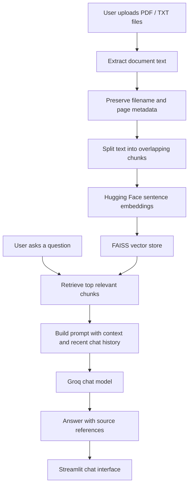

# AI Document Q&A Chatbot

<p align="center">
  <strong>Ask questions about your own PDF and TXT documents using Retrieval-Augmented Generation (RAG).</strong>
</p>

<p align="center">
  <a href="https://document-app-project2.streamlit.app/">Live Demo</a> ·
  <a href="https://github.com/suryaprakash87436/Document-QA-Project">Source Code</a>
</p>

---

## Table of Contents

- [Project Overview](#project-overview)
- [Problem Statement](#problem-statement)
- [Project Objectives](#project-objectives)
- [Key Features](#key-features)
- [Skills and Technologies](#skills-and-technologies)
- [System Architecture](#system-architecture)
- [How It Works](#how-it-works)
- [Project Structure](#project-structure)
- [Getting Started](#getting-started)
- [Configuration](#configuration)
- [Run the Application](#run-the-application)
- [Deployment](#deployment)
- [Limitations](#limitations)
- [Possible Future Enhancements](#possible-future-enhancements)
- [Resume-Ready Project Summary](#resume-ready-project-summary)

## Project Overview

The **AI Document Q&A Chatbot** is a document-grounded question-answering application built with Python, Streamlit, LangChain, FAISS, Hugging Face sentence embeddings and the Groq API.

Users can upload PDF or TXT files, process their contents and ask questions in a conversational interface. The application retrieves relevant text chunks from the uploaded documents and passes that context to a language model to generate an answer. Source filenames and page numbers are displayed to help users trace the information.

The application follows the **Retrieval-Augmented Generation (RAG)** approach: answers are generated using retrieved document content rather than relying only on the model's general knowledge.

## Problem Statement

Finding a specific fact in lengthy documents can be time-consuming. A general-purpose chatbot may also produce answers that are not supported by a user's files.

This project addresses that problem by creating a workflow that:
- Accepts user-provided PDF and TXT documents.
- Converts document text into searchable chunks and vector embeddings.
- Retrieves the most relevant chunks for a question.
- Generates a response grounded in the retrieved context.
- Shows source filenames and page references to support verification.

## Project Objectives

1. Build an interactive interface for uploading and querying documents.
2. Extract text from PDF and TXT files while retaining source metadata.
3. Split long content into manageable, overlapping chunks.
4. Create semantic vector representations using a Hugging Face embedding model.
5. Retrieve relevant chunks using a FAISS vector store.
6. Generate context-aware responses through the Groq-hosted language model.
7. Display source information and handle temporary API failures with retry logic.

## Key Features

- **Multiple document uploads:** Upload multiple PDF and TXT files in one session.
- **Configurable text splitting:** Adjust chunk size and chunk overlap before indexing.
- **Semantic retrieval:** Use the `sentence-transformers/all-MiniLM-L6-v2` embedding model with FAISS.
- **Context-grounded answers:** The prompt instructs the model to answer from retrieved document context and avoid inventing unsupported facts.
- **Source references:** Display source filename, page number and a short excerpt for retrieved content.
- **Conversational interface:** Ask follow-up questions while retaining recent chat context.
- **API retry handling:** Retry selected temporary service errors with exponential backoff.
- **Session controls:** Clear the indexed documents and chat history from the interface.

## Skills and Technologies

| Area | Technologies / Skills |
|---|---|
| Programming | Python |
| User interface | Streamlit |
| Generative AI | Large Language Models (LLMs), prompt design |
| RAG pipeline | Retrieval-Augmented Generation, context construction |
| Orchestration | LangChain, LangChain Core |
| Embeddings | Hugging Face, Sentence Transformers |
| Vector search | FAISS similarity search |
| Document processing | PyPDF, PDF/TXT text extraction |
| Text processing | Recursive character text splitting, chunk overlap |
| API integration | Groq API, environment variables |
| Reliability | Retry handling with Tenacity |
| Version control | Git, GitHub |
| Deployment | Streamlit Community Cloud |

## System Architecture



## How It Works

1. **Upload:** The user selects one or more PDF or TXT files.
2. **Extract:** PDF pages are read individually; TXT content is decoded as UTF-8.
3. **Chunk:** The extracted text is split into overlapping chunks. Chunk size and overlap are configurable in the interface.
4. **Embed:** Hugging Face converts each chunk into a numerical embedding.
5. **Index:** FAISS stores the embeddings for similarity-based retrieval.
6. **Ask:** The user enters a question in the chat interface.
7. **Retrieve:** The application retrieves the four most relevant chunks by default.
8. **Generate:** LangChain combines retrieved context, the question and recent conversation history, then invokes the Groq chat model.
9. **Show sources:** The answer is displayed with source filenames, page numbers and excerpts.

## Project Structure

```text
Document-QA-Project/
├── app.py                 # Streamlit interface and chat flow
├── src/
│   ├── __init__.py
│   └── rag.py             # File reading, chunking, FAISS and RAG logic
├── requirements.txt       # Python dependencies
├── .gitignore             # Excludes local and sensitive files
└── README.md              # Project documentation
```

## Getting Started

### Prerequisites

- Python 3.10 or newer (Python 3.11 is a suitable choice).
- A Groq API key.
- Git.

### 1. Clone the repository

```bash
git clone https://github.com/suryaprakash87436/Document-QA-Project.git
cd Document-QA-Project
```

### 2. Create a virtual environment

**Windows PowerShell**
```powershell
py -m venv .venv
.\.venv\Scripts\Activate.ps1
```

**macOS / Linux**
```bash
python3 -m venv .venv
source .venv/bin/activate
```

### 3. Install dependencies

```bash
python -m pip install --upgrade pip
pip install -r requirements.txt
```

## Configuration

Create a file named `.env` in the project root:

```env
GROQ_API_KEY=your_groq_api_key
```

The application reads this value through `python-dotenv`. Keep the real key private. Do not commit `.env` or paste the key into source code, README files, screenshots or public issues.

For Streamlit Community Cloud, add `GROQ_API_KEY` under the app's **Settings → Secrets** using TOML syntax:

```toml
GROQ_API_KEY = "your_groq_api_key"
```

## Run the Application

```bash
streamlit run app.py
```

Open the local URL printed by Streamlit, usually `http://localhost:8501`.

## Deployment

The application is published on **Streamlit Community Cloud**:

**[Open AI Document Q&A Chatbot](https://document-app-project2.streamlit.app/)**

If you deploy your own copy:
1. Fork or clone this repository to your GitHub account.
2. Create an app in [Streamlit Community Cloud](https://share.streamlit.io/).
3. Select this repository and the `main` branch.
4. Set the main file path to `app.py`.
5. Add `GROQ_API_KEY` in the app's Secrets settings.
6. Deploy and verify document upload and question answering.

## Limitations

- Only PDF and TXT uploads are supported by the current interface.
- Scanned/image-only PDFs are not OCR-processed; they may produce no extractable text.
- The FAISS index is built for the current Streamlit session and is not a persistent document database.
- Answers depend on the quality and content of the uploaded files and retrieved chunks.
- Groq API access and a valid API key are required to generate answers.
- The application is intended for document assistance; users should verify important information against the original source.

## Possible Future Enhancements

- Add OCR support for scanned PDFs and images.
- Persist vector indexes so users can reuse processed document collections.
- Add support for DOCX, CSV and additional file formats.
- Add document-level filters and configurable retrieval settings.
- Add automated tests and CI checks for the RAG pipeline.
- Add downloadable answers with source references and conversation export.

## Resume-Ready Project Summary

**AI Document Q&A Chatbot | Python, Streamlit, LangChain, RAG, Hugging Face, FAISS, Groq API**

- Developed a document question-answering application that accepts multiple PDF and TXT files through a Streamlit interface.
- Implemented a RAG pipeline using recursive text chunking, Hugging Face sentence embeddings and FAISS similarity search.
- Integrated a Groq-hosted LLM through LangChain to generate responses grounded in retrieved document context.
- Displayed source filenames, page numbers and text excerpts to improve answer traceability.
- Added configurable chunking, conversational context and retry handling for selected temporary API errors.

---

**Author:** Surya Prakash  
**Repository:** [suryaprakash87436/Document-QA-Project](https://github.com/suryaprakash87436/Document-QA-Project)
